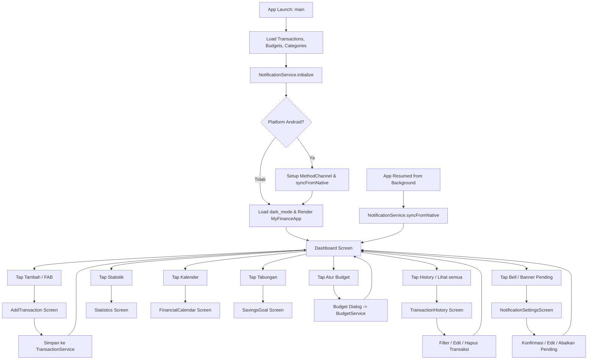
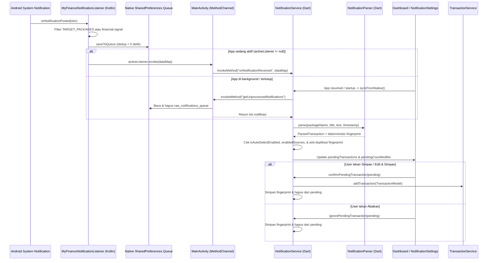

# PROJECT_CONTEXT.md — MyFinance

Dokumen ini berisi konteks teknis lengkap proyek **MyFinance**, disusun langsung berdasarkan inspeksi source code, konfigurasi, dan hasil eksekusi analyzer/test pada repositori.

---

## 1. Project Overview

**MyFinance** adalah aplikasi manajemen keuangan pribadi berbasis **Flutter** (dengan integrasi native Android) untuk mencatat pemasukan dan pengeluaran, memantau anggaran periode bulanan, menganalisis statistik pengeluaran per kategori, memantau aktivitas harian melalui kalender keuangan, mengelola target tabungan (*savings goals*), serta mendeteksi transaksi secara otomatis dari notifikasi aplikasi bank dan e-wallet Android.

- **Nama Aplikasi (Android Label):** `MyFinance` (`android/app/src/main/AndroidManifest.xml`)
- **Nama Paket Pubspec:** `test_flutter` versi `1.0.0+1` (`pubspec.yaml`)
- **Application ID / Namespace Android:** `com.example.test_flutter` (`android/app/build.gradle.kts`)
- **Mode Penyimpanan:** Local-first / offline-only menggunakan `SharedPreferences` (tanpa backend server atau cloud database).

---

## 2. Technology Stack

| Komponen | Teknologi / Versi | Sumber |
|---|---|---|
| Framework UI | Flutter SDK (Material 3, Light & Dark Mode) | `pubspec.yaml`, `lib/main.dart` |
| Bahasa Pemrograman (App) | Dart SDK `^3.13.4` | `pubspec.yaml` |
| Bahasa Pemrograman (Native) | Kotlin (JVM target 17) | `android/app/build.gradle.kts`, `android/app/src/main/kotlin/com/example/test_flutter/*.kt` |
| Grafik / Visualisasi | `fl_chart: ^1.2.0` (`BarChart`) | `pubspec.yaml`, `lib/screens/dashboard.dart` |
| Penyimpanan Lokal | `shared_preferences: ^2.5.5` | `pubspec.yaml`, `lib/services/*.dart`, `lib/screens/savings_goal.dart` |
| Ikon UI | `cupertino_icons: ^1.0.8`, Material Icons | `pubspec.yaml` |
| Linter & Static Analysis | `flutter_lints: ^6.0.0` | `pubspec.yaml`, `analysis_options.yaml` |
| App Icon Generator | `flutter_launcher_icons: ^0.14.4` | `pubspec.yaml` |
| Platform Bridge | Flutter `MethodChannel` (`com.myfinance.app/notification_listener`) | `lib/services/notification_service.dart`, `MainActivity.kt` |
| Android Native API | `NotificationListenerService`, `NotificationManagerCompat`, `Settings.Secure` | `MyFinanceNotificationListener.kt`, `MainActivity.kt` |

---

## 3. Folder Structure

Struktur direktori utama proyek:

```text
my-finance/
├── android/
│   └── app/
│       ├── build.gradle.kts
│       └── src/main/
│           ├── AndroidManifest.xml
│           └── kotlin/com/example/test_flutter/
│               ├── MainActivity.kt
│               └── MyFinanceNotificationListener.kt
├── assets/
│   └── icon/
│       └── myfinance_icon.png
├── lib/
│   ├── main.dart
│   ├── models/
│   │   ├── pending_transaction.dart
│   │   └── transaction_model.dart
│   ├── screens/
│   │   ├── add_transaction.dart
│   │   ├── dashboard.dart
│   │   ├── financial_calendar.dart
│   │   ├── notification_settings.dart
│   │   ├── savings_goal.dart
│   │   ├── statistics.dart
│   │   └── transaction_history.dart
│   ├── services/
│   │   ├── budget_service.dart
│   │   ├── category_service.dart
│   │   ├── notification_parser.dart
│   │   ├── notification_service.dart
│   │   └── transaction_service.dart
│   ├── utils/
│   │   └── rupiah_input_formatter.dart
│   └── widgets/
│       └── transaction_item.dart
├── test/
│   ├── notification_parser_test.dart
│   ├── notification_service_test.dart
│   └── widget_test.dart
├── analysis_options.yaml
└── pubspec.yaml
```

---

## 4. Application Architecture

Aplikasi menggunakan arsitektur **layered / service-based sederhana** tanpa library state management eksternal (seperti Provider, Riverpod, atau Bloc):

1. **Presentation Layer (`lib/screens/`, `lib/widgets/`):**
   - Seluruh halaman berupa `StatefulWidget` atau `StatelessWidget`.
   - State UI diperbarui dengan `setState()` setelah operasi async selesai atau setelah kembali dari navigasi (`Navigator.push(...)`).
   - Reaktivitas lintas widget untuk jumlah transaksi notifikasi pending menggunakan `ValueNotifier<int>` (`NotificationService.pendingCountNotifier`) yang di-consume dengan `ValueListenableBuilder<int>` di `Dashboard` (`lib/screens/dashboard.dart#L756-L810` & `#L945-L1024`).
   - Theme switching (Light/Dark) dikelola oleh `MyFinanceApp` (`lib/main.dart#L27-L95`) dan diteruskan ke `Dashboard` melalui callback `onToggleTheme`.

2. **Service / Business Logic Layer (`lib/services/`):**
   - Menggunakan class berisi **static fields dan static methods** sebagai singleton in-memory store sekaligus pengelola persistensi ke `SharedPreferences`:
     - `TransactionService` (`lib/services/transaction_service.dart`)
     - `BudgetService` (`lib/services/budget_service.dart`)
     - `CategoryService` (`lib/services/category_service.dart`)
     - `NotificationService` (`lib/services/notification_service.dart`)
     - `NotificationParser` (`lib/services/notification_parser.dart`) — pure static utility untuk parsing teks notifikasi & pembuatan fingerprint.
   - *Catatan arsitektur:* Fitur **Savings Goal** (`lib/screens/savings_goal.dart`) belum dipisahkan ke service tersendiri; state dan baca/tulis `SharedPreferences` ditangani langsung di dalam `_SavingsGoalState`.

3. **Data / Model Layer (`lib/models/`):**
   - `TransactionModel` (`lib/models/transaction_model.dart`) untuk transaksi utama.
   - `PendingTransaction` (`lib/models/pending_transaction.dart`) untuk transaksi hasil deteksi notifikasi sebelum dikonfirmasi.

4. **Native Android Layer (`android/app/src/main/kotlin/com/example/test_flutter/`):**
   - `MyFinanceNotificationListener` menangkap notifikasi sistem secara background dan menyimpannya ke antrean `SharedPreferences` native (`MyFinanceNotificationPrefs`).
   - `MainActivity` menjembatani antrean tersebut dan event real-time ke Flutter melalui `MethodChannel`.

---

## 5. Application Flow

### Alur Startup & Siklus Hidup Aplikasi

1. `main()` di `lib/main.dart#L10-L25` memanggil `WidgetsFlutterBinding.ensureInitialized()`, lalu memuat seluruh state secara berurutan:
   - `TransactionService.loadTransactions()`
   - `BudgetService.loadBudgets()`
   - `CategoryService.loadCategories()`
   - `NotificationService.initialize()` (termasuk registrasi `MethodCallHandler` dan `syncFromNative()` di Android)
   - Membaca preferensi tema `'dark_mode'` dari `SharedPreferences`.
2. Aplikasi me-render `MyFinanceApp` dengan `home: Dashboard(...)`.
3. `Dashboard` (`_DashboardState` dengan `WidgetsBindingObserver` di `lib/screens/dashboard.dart#L32-L56`) memantau `AppLifecycleState.resumed`. Setiap kali aplikasi kembali ke foreground, `NotificationService.syncFromNative()` dijalankan untuk menarik notifikasi yang masuk saat aplikasi tidak aktif, lalu UI di-refresh.

### Diagram Mermaid — Application Flow



---

## 6. Feature Breakdown

| Fitur | Lokasi Implementasi | Deskripsi Fungsional |
|---|---|---|
| **Dashboard Ringkasan & Grafik** | `lib/screens/dashboard.dart` | Menampilkan Total Saldo (`totalIncome - totalExpense`), Pemasukan & Pengeluaran bulan berjalan, Banner jumlah transaksi terdeteksi, Akses Cepat, Progress Budget periode aktif, Grafik batang 6 bulan terakhir (`fl_chart`), dan 4 Transaksi Terbaru. |
| **Theme Switcher (Light / Dark)** | `lib/main.dart#L48-L94`, `lib/screens/dashboard.dart#L746-L755` | Toggle tema terang/gelap yang disimpan ke `SharedPreferences` key `'dark_mode'`. |
| **Tambah Transaksi & Kategori Custom** | `lib/screens/add_transaction.dart`, `lib/services/category_service.dart` | Input jenis (`Pemasukan` / `Pengeluaran`), nama, nominal (format Rupiah ribuan bertitik), tanggal (`showDatePicker`), serta memilih/menambah/menghapus kategori custom beserta pilihan 20 ikon (`CategoryService.iconOptions`). |
| **Riwayat, Filter, Edit & Hapus Transaksi** | `lib/screens/transaction_history.dart`, `lib/services/transaction_service.dart` | Menampilkan seluruh transaksi, filter (`Semua`, `Pemasukan`, `Pengeluaran`), edit via `showModalBottomSheet`, dan hapus transaksi. |
| **Pengaturan Budget Periode Custom** | `lib/services/budget_service.dart`, `lib/screens/dashboard.dart#L264-L445` | Mengatur tanggal mulai periode (tanggal 1–28, default `25`) dan nominal budget per periode (default `Rp 2.000.000`). Menghitung progress & peringatan over-budget pada periode berjalan. |
| **Statistik Bulanan** | `lib/screens/statistics.dart` | Menampilkan ringkasan bulan berjalan: total pemasukan, pengeluaran, cash flow, jumlah transaksi, rata-rata pengeluaran, kategori pengeluaran terbesar, serta rincian persentase per kategori. |
| **Kalender Keuangan** | `lib/screens/financial_calendar.dart` | Kalender bulanan interaktif dengan penanda hari yang memiliki transaksi, ringkasan pemasukan/pengeluaran/selisih pada tanggal terpilih, dan daftar transaksi pada tanggal tersebut. |
| **Target Tabungan (Savings Goal)** | `lib/screens/savings_goal.dart` | CRUD target tabungan (`title`, `target`, `saved`, `deadline` opsional, `iconKey` dari 8 ikon) serta fitur tambah dana terkumpul, disimpan lokal. |
| **Auto Detect Transaksi (Notifikasi)** | `lib/screens/notification_settings.dart`, `lib/services/notification_service.dart`, `lib/services/notification_parser.dart` | Deteksi transaksi otomatis dari notifikasi bank/e-wallet Android, cek & buka pengaturan izin Notification Access, toggle aktif/nonaktif, filter sumber notifikasi, review/edit/konfirmasi/abaikan pending transaksi, serta **Tes Simulasi Notifikasi** (ikon lab di AppBar). |

---

## 7. Data Flow

1. **Manual Transaction Flow:**
   - User mengisi form di `AddTransaction` (`lib/screens/add_transaction.dart#L435-L462`) -> membentuk `TransactionModel` -> memanggil `TransactionService.addTransaction(transaction)` (`lib/services/transaction_service.dart#L102-L111`).
   - `TransactionService` menyisipkan ke index `0` list static `transactions` dan memanggil `_saveTransactions()` ke `SharedPreferences`.
   - Saat `Navigator.pop(context, transaction)` kembali ke `Dashboard`, `Dashboard` memanggil `setState(() {})` (`lib/screens/dashboard.dart#L609-L619`) sehingga saldo, budget progress, grafik 6 bulan, dan daftar transaksi terbaru langsung ter-update.

2. **Edit / Delete Transaction Flow:**
   - `TransactionHistory` memanggil `TransactionService.updateTransaction(...)` atau `TransactionService.deleteTransaction(id)` (`lib/services/transaction_service.dart#L117-L146`), menyimpan ke `SharedPreferences`, lalu saat kembali ke `Dashboard`, `Dashboard` melakukan `setState(() {})`.

3. **Category & Budget Flow:**
   - `AddTransaction` menambah/menghapus kategori custom via `CategoryService.addCategory(...)` / `deleteCategory(...)` (`lib/services/category_service.dart#L127-L184`).
   - `Dashboard` mengubah tanggal mulai atau nominal budget via `BudgetService.setStartDay(day)` dan `BudgetService.setBudget(DateTime.now(), amount)` (`lib/services/budget_service.dart#L81-L201`).

4. **Savings Goal Flow:**
   - `SavingsGoal` mengelola `List<Map<String, dynamic>> goals` secara lokal dan memanggil `loadGoals()` / `saveGoals()` langsung ke `SharedPreferences` (`lib/screens/savings_goal.dart#L65-L122`).

---

## 8. Local Storage dan Persistence

Seluruh data persisten disimpan di perangkat menggunakan `SharedPreferences`:

### A. Flutter SharedPreferences Keys

| Key | Tipe | Pengelola | Isi / Format |
|---|---|---|---|
| `'transactions'` | `String` (JSON Array) | `TransactionService` (`lib/services/transaction_service.dart#L10`) | List `TransactionModel` (`id`, `title`, `category`, `amount`, `isIncome`, `date` ISO-8601). |
| `'monthly_budgets'` | `String` (JSON Object) | `BudgetService` (`lib/services/budget_service.dart#L10`) | Map `<String, double>` dengan key periode `YYYY-M` (contoh: `'2026-9'`). |
| `'budget_start_day'` | `int` | `BudgetService` (`lib/services/budget_service.dart#L11`) | Tanggal mulai periode budget (`1`–`28`, default `25`). |
| `'custom_categories'` | `String` (JSON Array) | `CategoryService` (`lib/services/category_service.dart#L73`) | List objek `{name, iconKey}` untuk kategori buatan user. |
| `'savings_goals'` | `String` (JSON Array) | `SavingsGoal` (`lib/screens/savings_goal.dart#L15`) | List objek `{title, target, saved, deadline, iconKey}`. |
| `'dark_mode'` | `bool` | `main.dart` (`lib/main.dart#L20, #L54`) | Status tema gelap (`true`/`false`). |
| `'pending_notification_transactions'` | `String` (JSON Array) | `NotificationService` (`lib/services/notification_service.dart#L14`) | List `PendingTransaction` yang menunggu konfirmasi/aksi user. |
| `'processed_notification_fingerprints'` | `List<String>` | `NotificationService` (`lib/services/notification_service.dart#L15`) | Maksimal 1000 fingerprint terakhir untuk anti-duplikasi (`_saveFingerprints()` `#L333-L339`). |
| `'notification_auto_detect_enabled'` | `bool` | `NotificationService` (`lib/services/notification_service.dart#L16`) | Status aktif fitur Auto Detect (default `true`). |
| `'notification_confirm_required'` | `bool` | `NotificationService` (`lib/services/notification_service.dart#L17`) | Preferensi konfirmasi transaksi (default `true`). |
| `'notification_enabled_sources'` | `List<String>` | `NotificationService` (`lib/services/notification_service.dart#L18`) | Sumber notifikasi yang diizinkan (`BCA`, `BRI`, `Mandiri`, `DANA`, `GoPay`, `OVO`, `ShopeePay`). |

### B. Android Native SharedPreferences (terpisah dari Flutter `FlutterSharedPreferences`)

| File Prefs (`PREFS_NAME`) | Key (`KEY_QUEUE`) | Pengelola | Isi / Format |
|---|---|---|---|
| `'MyFinanceNotificationPrefs'` | `'raw_notifications_queue'` | `MyFinanceNotificationListener.kt#L13-L14`, `MainActivity.kt#L77-L110` | JSON Array berisi `{packageName, title, text, timestamp}` yang tertampung saat aplikasi Flutter tertutup/di background. Dihapus setelah diambil oleh `getUnprocessedNotifications`. |

---

## 9. Notification System Architecture

Sistem deteksi transaksi otomatis terdiri dari dua tahap utama: **Native Capture & Queueing** (Kotlin) dan **Parsing, Deduplication & Confirmation** (Dart).

### 1. Native Capture & Filtering (`MyFinanceNotificationListener.kt`)
- Saat notifikasi masuk (`onNotificationPosted`), service mengekstrak `packageName`, `EXTRA_TITLE`, dan `EXTRA_BIG_TEXT` / `EXTRA_TEXT`.
- Notifikasi lolos filter jika `packageName` ada di `TARGET_PACKAGES` **atau** teks mengandung sinyal finansial (`rp`, `transfer`, `pembayaran`, `qris`, `top up`, `saldo`, `masuk`, `keluar`, `debit`, `credit`).
- Disimpan ke `MyFinanceNotificationPrefs` dengan deduplikasi 5 detik (`Math.abs(timestamp1 - timestamp2) < 5000`) untuk payload yang sama (`saveToQueue()` `#L88-L125`).
- Jika `MainActivity` sedang aktif (`activeListener != null`), data langsung dikirim real-time lewat `MethodChannel.invokeMethod("onNotificationReceived", dataMap)` (`MainActivity.kt#L50-L54`).

### 2. Parsing & Anti-Duplikasi (`NotificationParser` & `NotificationService`)
- `NotificationParser.parse()` (`lib/services/notification_parser.dart#L68-L109`):
  - **Nominal (`extractAmount` & `parseFormattedNumber`):** Mendukung format Indonesia (`Rp25.000`, `Rp 1.500.000,00`, `25.000`) maupun format koma ribuan (`25,000`, `1,500,000.00`).
  - **Sumber (`detectSource`):** Mencocokkan `packageName` dengan `packageToSource`, lalu fallback ke keyword pada title/text (`BCA`, `BRI`, `Mandiri`, `DANA`, `GoPay`, `OVO`, `ShopeePay`, `BNI`, atau `'Lainnya'`).
  - **Jenis (`detectIsIncome`):** Mencocokkan frasa pemasukan kuat (`transfer masuk`, `dana masuk`, `cashback`, dll.), frasa pengeluaran kuat (`transfer keluar`, `pembayaran`, `qris`, `debit`, dll.), dan keyword umum (`masuk`, `received`, dll.). Default `false` (pengeluaran).
  - **Kategori (`detectCategory`):** Mengelompokkan ke `Gaji` (jika income), atau `Makanan`, `Transportasi`, `Belanja`, `Hiburan`, `Tagihan`, serta default `Makanan` untuk `qris` tanpa merchant spesifik, atau `Lainnya`.
  - **Fingerprint (`generateFingerprint`):** Format `fp_{source}_{packageName}_{amountKey}_{IN|OUT}_{YYYYMMDD_HHmm}_{normalizedTitle}` (resolusi per 1 menit) untuk mencegah notifikasi ganda masuk dua kali.
- `NotificationService.processRawNotification()` (`lib/services/notification_service.dart#L127-L169`):
  - Memeriksa `isAutoDetectEnabled`, `enabledSources`, `processedFingerprints`, dan `pendingTransactions`.
  - Menambahkan ke `pendingTransactions`, menyimpan ke `SharedPreferences`, dan memperbarui `pendingCountNotifier`.

### 3. Konfirmasi / Abaikan
- **Simpan / Edit & Simpan (`confirmPendingTransaction`):** Mengonversi `PendingTransaction` -> `TransactionModel`, menambah ke `TransactionService`, mencatat `fingerprint` ke `processedFingerprints`, dan menghapus dari `pendingTransactions`.
- **Abaikan (`ignorePendingTransaction` / `clearAllPending`):** Mencatat `fingerprint` ke `processedFingerprints` agar notifikasi serupa tidak muncul lagi, lalu menghapus dari `pendingTransactions`.

### Diagram Mermaid — Notification Flow



---

## 10. Android Native Integration

1. **Manifest Declaration (`android/app/src/main/AndroidManifest.xml#L34-L43`):**
   - Mendeklarasikan service `.MyFinanceNotificationListener` dengan permission `android.permission.BIND_NOTIFICATION_LISTENER_SERVICE`, `android:exported="true"`, dan intent-filter `android.service.notification.NotificationListenerService`.
2. **MethodChannel Contract (`MainActivity.kt#L13-L55` & `NotificationService.dart#L11-L125`):**
   - Channel name: `com.myfinance.app/notification_listener`
   - Method yang dipanggil Flutter -> Android:
     - `isNotificationAccessGranted`: Mengecek izin melalui `NotificationManagerCompat.getEnabledListenerPackages(this)` dan fallback `Settings.Secure.getString(contentResolver, "enabled_notification_listeners")`.
     - `openNotificationAccessSettings`: Membuka layar sistem `Settings.ACTION_NOTIFICATION_LISTENER_SETTINGS`.
     - `getUnprocessedNotifications`: Mengambil seluruh item dari `MyFinanceNotificationPrefs` key `raw_notifications_queue` lalu menghapus queue.
     - `clearNotificationQueue`: Menghapus `raw_notifications_queue`.
   - Method yang dipanggil Android -> Flutter:
     - `onNotificationReceived`: Mengirim map `{packageName, title, text, timestamp}` ke UI thread saat aplikasi aktif.
3. **Target Package Android yang Didukung (`MyFinanceNotificationListener.kt#L20-L32`):**
   - BCA: `com.bca`, `com.bca.mybca`, `mybca.bca.co.id`
   - Mandiri: `id.bmri.livin`
   - BRI: `com.bri.bmo`
   - BNI: `id.co.bni.newmbanking`
   - DANA: `id.dana`
   - GoPay / Gojek: `com.gojek.app`, `com.gopay.wallet`
   - OVO: `ovo.id`
   - ShopeePay / Shopee: `com.shopee.id`

---

## 11. Navigation Flow

Navigasi menggunakan **imperative navigation** (`Navigator.push` dengan `MaterialPageRoute` dan `Navigator.pop`) tanpa named routes maupun router package (`go_router` tidak digunakan).

- **Root Screen:** `Dashboard` (`lib/main.dart#L89-L92`)
- **Rute dari `Dashboard` (`lib/screens/dashboard.dart`):**
  - AppBar Bell Icon (`#L765-L773`) / Pending Banner (`#L954-L961`) -> `NotificationSettingsScreen`
  - Quick Action `Tambah` / FAB `Transaksi` (`#L611-L619`) -> `AddTransaction`
  - Quick Action `Statistik` (`#L624-L632`) -> `Statistics`
  - Quick Action `Kalender` (`#L650-L659`) -> `FinancialCalendar`
  - Quick Action `Tabungan` (`#L637-L645`) -> `SavingsGoal`
  - Quick Action `History` / `Lihat semua` (`#L663-L672`) -> `TransactionHistory`
- Setelah `await Navigator.push(...)` selesai pada setiap rute di atas, `Dashboard` memanggil `if (mounted) setState(() {});` untuk menyinkronkan tampilan dengan perubahan data terbaru.

---

## 12. Current Implementation Status

Hasil verifikasi langsung pada workspace (per 20 November 2026):

- **Static Analysis (`flutter analyze`):** `No issues found! (ran in 1.1s)`
- **Automated Tests (`flutter test`):** **25/25 test passed** (`All tests passed!`), mencakup:
  - `test/widget_test.dart`: 1 smoke widget test (`MyFinanceApp smoke test & dashboard renders properly`).
  - `test/notification_parser_test.dart`: Unit test parsing nominal Rupiah/koma/titik, deteksi income vs expense, deteksi sumber & kategori, dan deterministik fingerprint.
  - `test/notification_service_test.dart`: Unit test simulasi notifikasi, penolakan duplikat, konfirmasi pending ke `TransactionService`, pengabaian pending, dan pelestarian transaksi eksisting.
- **Status Platform:** Fitur inti keuangan (transaksi, budget, statistik, kalender, tabungan, dark mode) berjalan di Flutter secara lintas platform; fitur **Notification Listener** berjalan khusus pada **Android** (dilindungi pengecekan `!kIsWeb && defaultTargetPlatform == TargetPlatform.android` di `NotificationService`).

---

## 13. Known Issues dan Technical Debt

Berdasarkan inspeksi source code saat ini:

1. **Pengaturan `isConfirmRequired` belum mempengaruhi alur auto-save:**
   - `NotificationService.isConfirmRequired` (`lib/services/notification_service.dart#L24, #L257-L261`) sudah memiliki toggle UI di `NotificationSettingsScreen` (`lib/screens/notification_settings.dart#L415-L422`) dan tersimpan di `SharedPreferences`.
   - Namun, `NotificationService.processRawNotification()` (`lib/services/notification_service.dart#L127-L169`) selalu memasukkan transaksi terdeteksi ke `pendingTransactions` dan belum memiliki percabangan untuk langsung memanggil `confirmPendingTransaction` ketika `isConfirmRequired == false`.
2. **Ketidaksinkronan dukungan sumber `BNI`:**
   - `MyFinanceNotificationListener.TARGET_PACKAGES` (`MyFinanceNotificationListener.kt#L26`) dan `NotificationParser.packageToSource` (`lib/services/notification_parser.dart#L48`) sudah mencantumkan `id.co.bni.newmbanking` (`'BNI'`).
   - Namun, `NotificationParser.supportedSources` (`#L57-L65`), `NotificationService.enabledSources` (`#L25-L33`), dan `NotificationSettingsScreen._sources` (`#L20-L28`) hanya mendaftarkan 7 sumber (`BCA`, `BRI`, `Mandiri`, `DANA`, `GoPay`, `OVO`, `ShopeePay`). Akibatnya, pengecekan `!enabledSources.contains(parsed.source)` di `NotificationService.processRawNotification()` (`#L145`) akan menolak notifikasi dari `BNI`.
3. **Potensi duplikasi pemrosesan antara `onNotificationReceived` dan `syncFromNative()`:**
   - Di `MyFinanceNotificationListener.onNotificationPosted` (`#L79-L82`), notifikasi disimpan ke `MyFinanceNotificationPrefs` **dan** langsung dikirim via `activeListener` saat aplikasi aktif. Jika aplikasi kemudian di-resume sebelum queue dibersihkan, `syncFromNative()` akan membaca ulang item dari queue. Hal ini saat ini tertangani di sisi Dart oleh `processedFingerprints` dan pengecekan `pendingTransactions`, namun hanya jika item masih ada di `pendingTransactions` atau sudah dikonfirmasi/diabaikan.
4. **Duplikasi helper formatting & parsing Rupiah:**
   - `lib/utils/rupiah_input_formatter.dart` sudah tersedia, tetapi `_RupiahInputFormatter`, `parseRupiah`, dan `formatRupiah` masih ditulis ulang di beberapa file screen (`dashboard.dart`, `add_transaction.dart`, `transaction_history.dart`, `savings_goal.dart`, `statistics.dart`, `financial_calendar.dart`, `notification_settings.dart`).
5. **Persistence `SavingsGoal` tercampur di UI state:**
   - Berbeda dengan transaksi, budget, kategori, dan notifikasi yang masing-masing memiliki class di `lib/services/`, logika `SharedPreferences` untuk tabungan (`savings_goals`) berada langsung di `_SavingsGoalState` (`lib/screens/savings_goal.dart#L65-L122`).
6. **Package/Application ID masih template default Flutter:**
   - `pubspec.yaml` (`name: test_flutter`), `android/app/build.gradle.kts` (`namespace` & `applicationId = "com.example.test_flutter"`), dan struktur package Kotlin (`com.example.test_flutter`) masih menggunakan nama placeholder awal.
7. **Cakupan pengujian (Test Coverage):**
   - Belum ada unit test khusus untuk `TransactionService`, `BudgetService`, `CategoryService`, dan `SavingsGoal`, serta belum ada widget test untuk alur interaksi form atau layar selain `Dashboard`.

---

## 14. Important Files dan Fungsinya

| File | Fungsi Utama |
|---|---|
| [lib/main.dart](file:///c:/Tugas/Projek_Pribadi/my-finance/lib/main.dart) | Entry point aplikasi, inisialisasi seluruh service, konfigurasi Material 3 Light/Dark theme, dan root widget `MyFinanceApp`. |
| [lib/models/transaction_model.dart](file:///c:/Tugas/Projek_Pribadi/my-finance/lib/models/transaction_model.dart) | Model data transaksi utama (`id`, `title`, `category`, `amount`, `isIncome`, `date`) beserta serialisasi JSON. |
| [lib/models/pending_transaction.dart](file:///c:/Tugas/Projek_Pribadi/my-finance/lib/models/pending_transaction.dart) | Model data transaksi pending hasil deteksi notifikasi, dilengkapi `fingerprint`, `source`, `rawText`, `copyWith`, dan konversi `toTransactionModel()`. |
| [lib/services/transaction_service.dart](file:///c:/Tugas/Projek_Pribadi/my-finance/lib/services/transaction_service.dart) | CRUD transaksi utama, agregasi `totalIncome` / `totalExpense` / `totalBalance`, dan persistensi ke `SharedPreferences` (`transactions`). |
| [lib/services/budget_service.dart](file:///c:/Tugas/Projek_Pribadi/my-finance/lib/services/budget_service.dart) | Pengelolaan nominal budget per periode, perhitungan rentang tanggal periode custom (`1`–`28`), dan persistensi ke `SharedPreferences`. |
| [lib/services/category_service.dart](file:///c:/Tugas/Projek_Pribadi/my-finance/lib/services/category_service.dart) | Daftar kategori default (6 kategori), 20 pilihan ikon, dan CRUD kategori custom di `SharedPreferences`. |
| [lib/services/notification_service.dart](file:///c:/Tugas/Projek_Pribadi/my-finance/lib/services/notification_service.dart) | Bridge `MethodChannel`, sinkronisasi antrean native, manajemen pengaturan auto-detect, anti-duplikasi fingerprint, konfirmasi/abaikan pending, dan simulasi notifikasi. |
| [lib/services/notification_parser.dart](file:///c:/Tugas/Projek_Pribadi/my-finance/lib/services/notification_parser.dart) | Parser teks notifikasi bank/e-wallet Indonesia (nominal, sumber, tipe income/expense, kategori, judul bersih, dan fingerprint deterministik). |
| [lib/screens/dashboard.dart](file:///c:/Tugas/Projek_Pribadi/my-finance/lib/screens/dashboard.dart) | Halaman utama: ringkasan saldo, banner transaksi terdeteksi, akses cepat, kartu budget periode, bar chart 6 bulan (`fl_chart`), dan daftar transaksi terbaru. |
| [lib/screens/add_transaction.dart](file:///c:/Tugas/Projek_Pribadi/my-finance/lib/screens/add_transaction.dart) | Form tambah transaksi dan dialog manajemen kategori custom. |
| [lib/screens/transaction_history.dart](file:///c:/Tugas/Projek_Pribadi/my-finance/lib/screens/transaction_history.dart) | Daftar riwayat transaksi, filter tipe, bottom sheet edit transaksi, dan hapus transaksi. |
| [lib/screens/statistics.dart](file:///c:/Tugas/Projek_Pribadi/my-finance/lib/screens/statistics.dart) | Analisis statistik pemasukan/pengeluaran bulan berjalan dan breakdown persentase per kategori. |
| [lib/screens/financial_calendar.dart](file:///c:/Tugas/Projek_Pribadi/my-finance/lib/screens/financial_calendar.dart) | Kalender bulanan untuk inspeksi transaksi per tanggal. |
| [lib/screens/savings_goal.dart](file:///c:/Tugas/Projek_Pribadi/my-finance/lib/screens/savings_goal.dart) | Pengelolaan daftar target tabungan dan progres dana terkumpul. |
| [lib/screens/notification_settings.dart](file:///c:/Tugas/Projek_Pribadi/my-finance/lib/screens/notification_settings.dart) | UI pengaturan Auto Detect Transaksi, status izin Notification Access, daftar transaksi pending, dan dialog Tes Simulasi Notifikasi. |
| [lib/widgets/transaction_item.dart](file:///c:/Tugas/Projek_Pribadi/my-finance/lib/widgets/transaction_item.dart) | Widget kartu item transaksi reusable di `Dashboard`. |
| [lib/utils/rupiah_input_formatter.dart](file:///c:/Tugas/Projek_Pribadi/my-finance/lib/utils/rupiah_input_formatter.dart) | Utility `TextInputFormatter` dan fungsi `parseRupiah()` untuk input nominal Rupiah. |
| [android/app/src/main/kotlin/com/example/test_flutter/MainActivity.kt](file:///c:/Tugas/Projek_Pribadi/my-finance/android/app/src/main/kotlin/com/example/test_flutter/MainActivity.kt) | Handler `MethodChannel` Android untuk izin notifikasi, pembacaan/penghapusan queue native, dan forwarding real-time. |
| [android/app/src/main/kotlin/com/example/test_flutter/MyFinanceNotificationListener.kt](file:///c:/Tugas/Projek_Pribadi/my-finance/android/app/src/main/kotlin/com/example/test_flutter/MyFinanceNotificationListener.kt) | `NotificationListenerService` Android untuk menangkap, memfilter, mendeduplikasi, dan menyimpan notifikasi bank/e-wallet ke `MyFinanceNotificationPrefs`. |
| [android/app/src/main/AndroidManifest.xml](file:///c:/Tugas/Projek_Pribadi/my-finance/android/app/src/main/AndroidManifest.xml) | Konfigurasi aplikasi Android dan registrasi `MyFinanceNotificationListener` service. |

---

## 15. Development Guidelines

1. **Konsistensi Persistensi & Kompatibilitas Key `SharedPreferences`:**
   - Jangan mengubah nama key `SharedPreferences` yang sudah ada (`transactions`, `monthly_budgets`, `budget_start_day`, `custom_categories`, `savings_goals`, `dark_mode`, dan key milik `NotificationService`) agar data pengguna yang tersimpan tidak hilang atau rusak.
2. **Menjaga Kontrak `MethodChannel` Android–Flutter:**
   - Perubahan nama channel (`com.myfinance.app/notification_listener`), nama method (`isNotificationAccessGranted`, `openNotificationAccessSettings`, `getUnprocessedNotifications`, `clearNotificationQueue`, `onNotificationReceived`), atau struktur payload map (`packageName`, `title`, `text`, `timestamp`) harus dilakukan secara sinkron di `MainActivity.kt`, `MyFinanceNotificationListener.kt`, dan `lib/services/notification_service.dart`.
3. **Menambahkan Sumber Bank / E-Wallet Baru:**
   - Pastikan sinkronisasi di **empat tempat**: `MyFinanceNotificationListener.TARGET_PACKAGES` (Kotlin), `NotificationParser.packageToSource` & `supportedSources` (Dart), `NotificationService.enabledSources` (Dart), dan `NotificationSettingsScreen._sources` (UI).
4. **Tema & Styling:**
   - Pertahankan dukungan Light Mode (`0xFFF4F1EA` background, `0xFF172033` primary navy) dan Dark Mode (`0xFF0F1522` background, `0xFF182131` card, `0xFFE8B85C` gold accent) pada setiap komponen baru.
5. **Pengujian & Analisis Sebelum Selesai:**
   - Selalu jalankan `flutter analyze` dan `flutter test` setelah melakukan perubahan kode. Gunakan `SharedPreferences.setMockInitialValues({})` dan `NotificationService.resetForTesting()` saat menulis unit/widget test.
